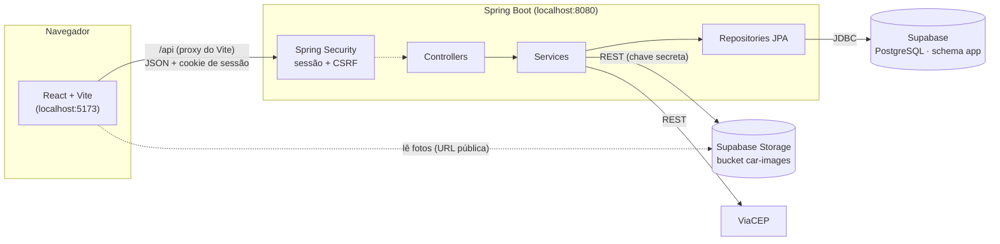

<table>
  <tr>
    <td width="800px">
      <div align="justify">
        Sistema web para <b>gestão de aluguéis de automóveis</b>: clientes escolhem um carro, fazem o pedido de aluguel pela internet e acompanham cada etapa; <b>agentes</b> (locadoras e bancos) avaliam os pedidos do ponto de vista financeiro, concedem crédito e executam o contrato.
      </div>
    </td>
    <td>
      <div align="center">
        
      </div>
    </td>
  </tr>
</table>

---

# 🏷 Rentacar — Sistema de Aluguel de Carros 🚗

## 🚧 Status do Projeto


---

## 📚 Índice

- [Links Úteis](#-links-úteis)
- [Sobre o Projeto](#-sobre-o-projeto)
- [Funcionalidades Principais](#-funcionalidades-principais)
- [Perfis de Usuário e Papel dos Agentes](#-perfis-de-usuário-e-papel-dos-agentes)
- [Regras de Negócio e Decisões de Projeto](#-regras-de-negócio-e-decisões-de-projeto)
- [Modelagem (Modelo de Dados e Histórias de Usuário)](#-modelagem-modelo-de-dados-e-histórias-de-usuário)
- [Tecnologias Utilizadas](#-tecnologias-utilizadas)
- [Arquitetura](#-arquitetura)
- [Instalação e Execução](#-instalação-e-execução)
    - [Pré-requisitos](#pré-requisitos)
    - [Configuração do Supabase](#-configuração-do-supabase)
    - [Variáveis de Ambiente](#-variáveis-de-ambiente)
    - [Instalação de Dependências](#-instalação-de-dependências)
    - [Como Executar a Aplicação](#-como-executar-a-aplicação)
- [Credenciais para Testes](#-credenciais-para-testes)
- [Dados de Demonstração](#-dados-de-demonstração)
- [Como Testar (Passo a Passo)](#-como-testar-passo-a-passo)
- [API REST](#-api-rest)
- [Testes Automatizados](#-testes-automatizados)
- [Estrutura de Pastas](#-estrutura-de-pastas)
- [Demonstração](#-demonstração)
- [Documentações utilizadas](#-documentações-utilizadas)
- [Autores](#-autores)
- [Contribuição](#-contribuição)
- [Agradecimentos](#-agradecimentos)
- [Licença](#-licença)

---

## 🔗 Links Úteis

- 📖 **Documentação da API (Swagger UI):** `http://localhost:8080/docs` (com o backend rodando)
    > 🧭 Lista todos os endpoints, com exemplos de requisição e resposta.
- 📐 **Modelo de dados e histórias de usuário:** veja a seção [Modelagem](#-modelagem-modelo-de-dados-e-histórias-de-usuário).

---

## 📝 Sobre o Projeto

O **Rentacar** é o protótipo desenvolvido no **Laboratório 02** da disciplina **Desenvolvimento e Integração de Aplicações Web (DIAW)** da PUC Minas: um sistema de apoio à gestão de aluguéis de automóveis que permite **efetuar, cancelar e modificar pedidos pela internet**.

O sistema funciona como uma **plataforma** que conecta três tipos de usuários:

- **Clientes** (pessoas físicas) se cadastram com seus dados de identificação, endereço, profissão e rendimentos, escolhem um carro e fazem pedidos de aluguel;
- **Locadoras** (agentes do tipo empresa) mantêm a frota, analisam os pedidos dos seus carros e executam os contratos;
- **Bancos** (agentes do tipo banco) analisam os pedidos que pedem financiamento e concedem o **contrato de crédito**.

Depois de introduzido, cada pedido passa por uma **análise financeira** feita por um agente. Com parecer positivo, o pedido fica disponível para a **execução do contrato**, que registra em nome de quem o carro fica durante o aluguel.

> [!NOTE]
> O sistema só pode ser utilizado após cadastro e autenticação (login com e-mail e senha).

---

## ✨ Funcionalidades Principais

- 🔐 **Autenticação por sessão:** login com e-mail e senha, sessão em cookie `HttpOnly`, proteção CSRF e senhas com BCrypt.
- 👤 **CRUD de cliente:** cadastro com RG, CPF (com validação dos dígitos verificadores), nome, endereço, profissão e até 3 entidades empregadoras com seus rendimentos; consulta e edição do perfil; troca de senha; exclusão da conta.
- 📮 **Endereço pelo CEP:** ao digitar o CEP, rua, bairro, cidade e UF são preenchidos automaticamente (via backend, consultando o ViaCEP).
- 🚘 **Catálogo de carros:** busca por marca ou modelo, foto, ano, placa, locadora e valor da diária.
- 📝 **Pedidos de aluguel:** o cliente escolhe as datas, vê o total calculado e pode pedir **crédito bancário**; enquanto o pedido está em análise, pode **alterar** as datas ou **cancelar**.
- 🧾 **Análise financeira:** a locadora dona do carro avalia os pedidos sem crédito; um banco avalia os pedidos com crédito, definindo **juros e parcelas** (Tabela Price).
- ✍️ **Contrato:** a locadora executa o contrato e registra a propriedade do carro durante o aluguel (cliente, locadora ou banco credor).
- 📅 **Acompanhamento:** status do pedido (Em análise, Aprovado, Recusado, Contratado, Em andamento, Encerrado, Cancelado) com filtros.
- 🏢 **Gestão da frota:** cada locadora cadastra, edita e exclui os próprios carros, com **upload de foto** para o Supabase Storage.
- 📖 **Documentação da API:** Swagger UI em `/docs`.

---

## 👥 Perfis de Usuário e Papel dos Agentes

| Perfil                             | Quem é                                     | O que faz no sistema                                                                                                                                                                                                       |
| ---------------------------------- | ------------------------------------------ | -------------------------------------------------------------------------------------------------------------------------------------------------------------------------------------------------------------------------- |
| 🧑 **Cliente**                     | Pessoa física cadastrada pelo próprio site | Mantém o perfil; consulta o catálogo; **cria, consulta, altera e cancela** os próprios pedidos; acompanha parecer, crédito e contrato                                                                                      |
| 🏢 **Locadora** (agente `COMPANY`) | Empresa parceira, dona de uma frota        | Cadastra, edita e exclui **os próprios carros** (com foto); **altera as datas** e **avalia** os pedidos **sem crédito** dos seus carros; **executa o contrato** dos pedidos aprovados dos seus carros; vê todos os pedidos |
| 🏦 **Banco** (agente `BANK`)       | Instituição financeira parceira            | **Altera as datas** e **avalia** os pedidos **com crédito** de qualquer locadora, definindo juros ao mês e número de parcelas, o que gera o **contrato de crédito**; vê todos os pedidos                                   |

**Quem pode agir em cada etapa do pedido**

| Etapa                                            | Pedido sem crédito     | Pedido com crédito     |
| ------------------------------------------------ | ---------------------- | ---------------------- |
| Criar, alterar, cancelar (enquanto "Em análise") | Cliente dono do pedido | Cliente dono do pedido |
| Alterar as datas (enquanto "Em análise")         | Locadora dona do carro | Qualquer banco         |
| Avaliar (aprovar ou recusar, com parecer)        | Locadora dona do carro | Qualquer banco         |
| Executar o contrato (pedido "Aprovado")          | Locadora dona do carro | Locadora dona do carro |

> [!NOTE]
> Agentes não se cadastram pelo site: locadoras e bancos são criados automaticamente quando o backend inicia (_seed_), com e-mail e senha definidos no arquivo `backend/.env`. Cada agente tem **um login por organização**.

---

## 📏 Regras de Negócio e Decisões de Projeto

- **Ciclo de vida do pedido:**

    ```mermaid
    stateDiagram-v2
        [*] --> SUBMITTED: cliente cria
        SUBMITTED --> SUBMITTED: cliente ou agente avaliador altera
        SUBMITTED --> CANCELLED: cliente cancela
        SUBMITTED --> APPROVED: agente aprova (parecer)
        SUBMITTED --> REJECTED: agente recusa (parecer)
        APPROVED --> CONTRACTED: locadora executa o contrato
        CONTRACTED --> [*]
        CANCELLED --> [*]
        REJECTED --> [*]
    ```

    Na tela, os status aparecem como _Em análise_, _Aprovado_, _Recusado_, _Contratado_ e _Cancelado_.

- **Contrato em andamento e encerrado:** a fase de um pedido contratado é **calculada pela data**, sem nada gravado no banco: antes da retirada é _Contratado_; entre a retirada e a devolução, _Em andamento_; a partir da devolução, _Encerrado_.
- **Propriedade do automóvel:** é um **registro no contrato**: ao executar o contrato, a locadora escolhe em nome de quem o carro fica durante o aluguel (cliente, locadora ou banco credor). A frota não muda de dono, e o carro volta a ficar disponível depois do período. O registro em nome do banco só é permitido quando há contrato de crédito.
- **Crédito bancário:** o contrato de crédito **financia o valor do aluguel** (diárias × valor da diária). O sistema não vende carros. As parcelas são fixas, calculadas pela **Tabela Price**.
- **Disponibilidade:** um carro não pode ter dois pedidos em andamento (_Em análise_, _Aprovado_ ou _Contratado_) com datas sobrepostas. Pedidos cancelados ou recusados liberam as datas. A data de devolução encerra a diária: de 10/11 a 13/11 são 3 diárias.
- **Valor do pedido:** o valor da diária é copiado para o pedido no momento em que ele é feito ou alterado, então mudanças de preço posteriores não afetam pedidos existentes.
- **Frota:** cada locadora vê e gerencia **apenas os próprios carros**. O catálogo completo é exibido aos clientes. Bancos não têm frota.
- **Exclusões lógicas:** excluir um cliente ou um carro preenche a data de exclusão (`deleted_at`) em vez de apagar a linha, preservando o histórico de pedidos. Contas excluídas não conseguem entrar. Carros com aluguel ainda não terminado não podem ser excluídos.
- **Imagens:** as fotos da frota inicial ficam no repositório (`frontend/public/cars`); as fotos enviadas pelas locadoras vão para o **Supabase Storage** (bucket público `car-images`), enviadas **somente pelo backend**. Apenas JPEG, PNG e WebP de até 2 MB, conferidos pelo conteúdo do arquivo.
- **O React só conversa com o backend:** não há acesso direto ao Supabase pelo navegador. A busca de CEP também passa pelo backend.

---

## 📐 Modelagem (Modelo de Dados e Histórias de Usuário)

Os artefatos de modelagem ficam na pasta [`docs/`](docs), versionados junto com o código. Os diagramas são escritos em Mermaid e o GitHub os exibe como imagens.

- 📖 **Histórias de usuário:** [docs/historias-de-usuario.md](docs/historias-de-usuario.md)
- 🎭 **Diagrama de casos de uso:** [docs/casos-de-uso.md](docs/casos-de-uso.md)
- 🧩 **Diagrama de classes:** [docs/diagrama-de-classes.md](docs/diagrama-de-classes.md)
- 🗃 **Modelo de dados:** [docs/modelo-de-dados.md](docs/modelo-de-dados.md)
- 📦 **Diagrama de pacotes (visão lógica):** [docs/diagrama-de-pacotes.md](docs/diagrama-de-pacotes.md)

---

## 🛠 Tecnologias Utilizadas

As versões abaixo são as usadas no desenvolvimento e são as recomendadas para executar o projeto.

### 💻 Front-end

- **Framework:** React 19
- **Linguagem:** TypeScript 6
- **Build tool:** Vite 8
- **Roteamento:** React Router 8
- **Estilização:** Tailwind CSS 4 (paleta inspirada em um _shot_ de referência do Dribbble), fonte Plus Jakarta Sans e ícones Lucide
- **Estado global:** React Context (sessão do usuário)
- **Qualidade de código:** ESLint e Prettier

### 🖥 Back-end

- **Linguagem/Runtime:** Java 25
- **Framework:** Spring Boot 4.0.9 (Spring MVC, Spring Data JPA, Spring Security, Bean Validation)
- **Build e dependências:** Apache Maven
- **Banco de dados:** PostgreSQL no **Supabase** (schema `app`), acessado via JDBC/JPA pelo _Session Pooler_
- **ORM:** Hibernate 7
- **Autenticação:** sessão HTTP (cookie `JSESSIONID`) com CSRF em cookie (`XSRF-TOKEN`) e senhas com BCrypt
- **Armazenamento de arquivos:** Supabase Storage (fotos dos carros)
- **Integração externa:** ViaCEP (busca de endereço por CEP)
- **Documentação da API:** springdoc-openapi (Swagger UI)

### ⚙ Infraestrutura & DevOps

- **Banco e arquivos:** Supabase (plano gratuito)
- **Execução:** local (backend na porta 8080 e frontend na porta 5173)

---

## 🏗 Arquitetura

O backend segue a arquitetura **MVC em camadas**: os _controllers_ recebem as requisições HTTP, os _services_ concentram as regras de negócio, os _repositories_ acessam o banco via JPA e os _models_ são as entidades. Os dados trafegam por **DTOs**: as entidades nunca são devolvidas diretamente ao frontend. O frontend é uma SPA em React que conversa **somente** com o backend.



**Fluxo de uma requisição autenticada:** o React chama `/api/...`; o proxy do Vite repassa ao Spring na mesma origem, enviando o cookie de sessão; o Spring Security confere a sessão, o papel do usuário (`CUSTOMER` ou `AGENT`) e, em requisições que alteram dados, o token CSRF; o controller valida o DTO e chama o service, que aplica as regras (por exemplo, "só a locadora dona do carro executa o contrato") e responde com outro DTO. Erros voltam em JSON (_problem details_, RFC 9457) e são traduzidos para português na interface.

**Principais entidades:** `User` (login e papel), `Customer` (dados do cliente, com `Address` embutido e até 3 `EmploymentIncome`), `Agent` (locadora ou banco), `Car` (com a locadora dona), `RentalOrder` (pedido), `CreditContract` (crédito concedido por um banco) e `Contract` (contrato executado pela locadora).

---

## 🔧 Instalação e Execução

### Pré-requisitos

- **Java JDK 25** (o Maven Wrapper `mvnw` já acompanha o projeto)
- **Node.js 20.19+ ou 22.12+** e **npm**
- Um projeto no **Supabase** (o plano gratuito é suficiente)
- Git

> [!TIP]
> Se o Java padrão da sua máquina for outro (por exemplo, o 17), aponte o `JAVA_HOME` para o JDK 25 só no terminal em que vai rodar o backend:
>
> ```powershell
> $env:JAVA_HOME = "C:\Program Files\Eclipse Adoptium\jdk-25.0.4.101-hotspot"
> ```
>
> No VS Code, o `.vscode/settings.json` do projeto já configura isso para os terminais integrados (ajuste o caminho do JDK se for diferente na sua máquina).

### 🗄 Configuração do Supabase

1. **Schema do banco:** no **SQL Editor**, crie o schema usado pelo sistema. As tabelas são criadas pelo Hibernate na primeira execução (`ddl-auto=update`):
    ```sql
    create schema if not exists app;
    ```
2. **Bucket de imagens:** em **Storage → New bucket**, crie o bucket `car-images` como **Public bucket**, com limite de **2 MB** e tipos `image/webp, image/png, image/jpeg`. **Não crie políticas de RLS**: o envio é feito só pelo backend, com a chave secreta.
3. **Valores de conexão:**
    - **Connect → Session pooler → JDBC:** URL do banco (`SUPABASE_DB_URL`);
    - **Project Settings → Data API:** _Project URL_ (`SUPABASE_URL`);
    - **Project Settings → API Keys:** chave **secret** (`sb_secret_...`) ou a legada **service_role** (`SUPABASE_SERVICE_ROLE_KEY`).

### 🔑 Variáveis de Ambiente

As variáveis do backend ficam em `backend/.env`, que é **ignorado pelo Git**. Copie o modelo e preencha:

```bash
cp backend/.env.example backend/.env
```

| Variável                    | Descrição                                                | Exemplo                                                                                                              |
| --------------------------- | -------------------------------------------------------- | -------------------------------------------------------------------------------------------------------------------- |
| `SUPABASE_DB_URL`           | URL JDBC do Session Pooler, com usuário, senha e SSL     | `jdbc:postgresql://<host>.pooler.supabase.com:5432/postgres?user=postgres.<ref>&password=<password>&sslmode=require` |
| `SUPABASE_URL`              | URL do projeto Supabase (Storage)                        | `https://<ref>.supabase.co`                                                                                          |
| `SUPABASE_SERVICE_ROLE_KEY` | Chave secreta do Supabase, usada **apenas** pelo backend | `sb_secret_...`                                                                                                      |
| `SEED_COMPANY_EMAIL`        | E-mail da locadora criada na inicialização               | `empresa@rentacar.com`                                                                                               |
| `SEED_COMPANY_PASSWORD`     | Senha da locadora (sem senha, ela não é criada)          | `senha1234`                                                                                                          |
| `SEED_BANK_EMAIL`           | E-mail do banco criado na inicialização                  | `banco@rentacar.com`                                                                                                 |
| `SEED_BANK_PASSWORD`        | Senha do banco (sem senha, ele não é criado)             | `senha1234`                                                                                                          |
| `SEED_CUSTOMER_PASSWORD`    | Senha dos clientes de demonstração (padrão `senha1234`)  | `senha1234`                                                                                                          |

> [!WARNING]
> A URL do banco contém a senha e a chave do Supabase dá acesso total ao projeto. Nunca as coloque no código, no frontend ou em um commit.

O **frontend não precisa de variáveis de ambiente**: o Vite repassa `/api` para `http://localhost:8080` (veja `frontend/vite.config.ts`).

### 📦 Instalação de Dependências

```bash
git clone https://github.com/lsivolella/Lab2.git
cd Lab2
```

#### Front-end (React)

```bash
cd frontend
npm install
```

#### Back-end (Spring Boot)

```bash
cd backend
./mvnw clean install -DskipTests
```

### ⚡ Como Executar a Aplicação

Use **dois terminais**.

#### Terminal 1: Back-end (Spring Boot)

```bash
cd backend
./mvnw spring-boot:run
```

O backend sobe em `http://localhost:8080` (Swagger UI em `http://localhost:8080/docs`). Na primeira execução ele cria as tabelas, as contas da locadora e do banco e a **frota inicial de 8 carros** (`backend/src/main/resources/seed/cars.json`). **A cada inicialização**, ele também recria os [dados de demonstração](#-dados-de-demonstração): dois clientes e pedidos em todas as situações, com datas relativas ao dia.

> [!IMPORTANT]
> Rode o backend **de dentro da pasta `backend`**: é de lá que ele lê o arquivo `.env`.

#### Terminal 2: Front-end (React, Vite)

```bash
cd frontend
npm run dev
```

Acesse **`http://localhost:5173`**.

---

## 🔐 Credenciais para Testes

| Perfil                                 | E-mail                           | Senha                                     |
| -------------------------------------- | -------------------------------- | ----------------------------------------- |
| 🏢 Locadora — _Rentacar Locadora Ltda_ | `empresa@rentacar.com`           | `senha1234`                               |
| 🏦 Banco — _Banco Rentacar S.A._       | `banco@rentacar.com`             | `senha1234`                               |
| 🧑 Cliente de demonstração — _Ana_     | `cliente@rentacar.com`           | `senha1234`                               |
| 🧑 Cliente de demonstração — _Bruno_   | `cliente2@rentacar.com`          | `senha1234`                               |
| 🧑 Novo cliente                        | criado pela tela **Cadastre-se** | escolhida no cadastro (8 a 72 caracteres) |

As contas de agente e de demonstração **não são criadas por usuários**: o backend as cria na inicialização (_seed_), com os valores de `SEED_*` do `backend/.env`. As senhas acima são as do `backend/.env.example`, que é o ponto de partida do `.env`.

**Dados de apoio para cadastrar um novo cliente** (fictícios):

- **CPFs válidos para teste:** `529.982.247-25`, `111.444.777-35`
- **CEP para testar o preenchimento automático:** `01310-100` (Avenida Paulista, São Paulo/SP)

> [!NOTE]
> As contas de agente são criadas **uma única vez**, na primeira inicialização. Trocar a senha no `.env` depois disso não altera uma conta já existente; para isso, use **Minha conta → Senha** dentro do sistema. Já os clientes de demonstração voltam à senha do `.env` a cada inicialização. São credenciais de demonstração para avaliação: em um ambiente real, defina senhas próprias no `.env`.

---

## 🎬 Dados de Demonstração

Para que todas as situações possam ser testadas sem preparação, **a cada inicialização** o backend (classe `DemoDataSeeder`):

1. cria os clientes de demonstração **Ana** (`cliente@rentacar.com`) e **Bruno** (`cliente2@rentacar.com`), ou os **restaura**, caso tenham sido excluídos ou tenham trocado a senha durante os testes;
2. **apaga todos os pedidos desses dois clientes** e cria 9 pedidos novos, com datas calculadas a partir do **dia em que o backend iniciou** (**D**).

| Cliente | Situação                                            | Período     | Bom para testar                                           |
| ------- | --------------------------------------------------- | ----------- | --------------------------------------------------------- |
| Ana     | Em análise, sem crédito                             | D+5 → D+8   | Locadora: alterar as datas e avaliar                      |
| Ana     | Em análise, com crédito                             | D+10 → D+15 | Banco: avaliar e definir juros e parcelas                 |
| Ana     | Aprovado, sem crédito                               | D+3 → D+6   | Locadora: executar o contrato (opções Locadora e Cliente) |
| Bruno   | Aprovado, com crédito (6 parcelas)                  | D+20 → D+25 | Locadora: executar o contrato com a opção Banco (credor)  |
| Bruno   | Recusado                                            | D+7 → D+9   | Visualizar o parecer                                      |
| Bruno   | Cancelado                                           | D+12 → D+14 | Filtro de cancelados                                      |
| Ana     | Contratado (ainda não começou)                      | D+30 → D+33 | Status _Contratado_                                       |
| Ana     | Contratado com crédito, registrado em nome do banco | D−2 → D+3   | Status _Em andamento_                                     |
| Bruno   | Contratado, registrado em nome do cliente           | D−15 → D−10 | Status _Encerrado_                                        |

- Os pedidos usam carros da locadora de demonstração. Se um carro já estiver ocupado nas datas por um pedido feito manualmente, o seeder escolhe outro carro livre.
- **Pedidos de outros clientes nunca são alterados.** Clientes criados pelo cadastro mantêm tudo o que for feito entre um reinício e outro.
- Para manter o banco como está entre reinícios, desligue o recurso em `backend/src/main/resources/application.properties`:
    ```properties
    app.seed.demo-data.enabled=false
    ```

> [!TIP]
> Antes de uma apresentação, reinicie o backend: os pedidos de demonstração voltam ao estado inicial, com as datas corretas para o dia.

---

## 🧪 Como Testar (Passo a Passo)

O roteiro abaixo percorre todos os perfis. Para alternar entre contas sem sair e entrar o tempo todo, use uma **janela anônima** para a segunda conta.

> [!TIP]
> Para ir direto às telas de agente, use os [dados de demonstração](#-dados-de-demonstração): os pedidos da Ana e do Bruno já cobrem todas as situações, e os passos 4 e 5 podem ser feitos com eles, sem criar pedidos antes.

### 1. Cadastro e login

1. Acesse `http://localhost:5173`: o sistema redireciona para **/login**.
2. Tente entrar com um e-mail inválido (ex.: `lucas`): a mensagem aparece embaixo do campo.
3. Clique em **Cadastre-se** e envie o formulário vazio: cada campo mostra o erro correspondente.
4. Preencha o cadastro do **Cliente A**:
    - CPF e CEP recebem máscara automaticamente;
    - ao digitar o CEP `01310-100`, o endereço é preenchido e o cursor vai para o **Número**;
    - adicione até 3 rendimentos (valores no formato `4.500,00`);
    - use o ícone de olho para conferir a senha.
5. Ao concluir, o cliente entra direto no catálogo. Recarregue a página: a sessão continua ativa.
6. Repita o cadastro com o mesmo e-mail ou CPF: o sistema avisa que já estão cadastrados.
7. Cadastre também um **Cliente B**, que será usado para testar a privacidade e a exclusão de conta.

### 2. Cliente: catálogo e pedidos (Cliente A)

1. Em **Carros**, busque por marca ou modelo e selecione um carro: o painel lateral mostra foto, ano, placa, locadora e o formulário de reserva.
2. Escolha as datas: o total (diárias × diária) é recalculado. Troque de carro: as datas são mantidas.
3. Faça um pedido **sem crédito** em um carro.
4. Faça outro pedido **com crédito** marcado, em outro carro.
5. Tente pedir o primeiro carro nas mesmas datas: o sistema informa que ele não está disponível.
6. Em **Meus pedidos**, confira os dois pedidos _Em análise_ e use os filtros de status.
7. Clique em **Alterar pedido**, mude a data de devolução e salve: as diárias e o total são recalculados.
8. Crie um terceiro pedido e **cancele-o**: o status passa a _Cancelado_ e as datas ficam livres de novo.
9. Entre como **Cliente B**: nenhum pedido do Cliente A aparece.

### 3. Cliente: perfil

1. Em **Meu perfil**, confira os dados do cadastro (CPF e e-mail não podem ser alterados).
2. Altere o endereço ou os rendimentos e clique em **Salvar alterações**.
3. Em **Senha**, tente trocar com a senha atual errada (aparece um aviso) e depois troque corretamente.
4. Com o **Cliente B**, use **Excluir conta**: o sistema volta ao login e essa conta não consegue mais entrar.

### 4. Locadora (`empresa@rentacar.com`)

1. Entre como locadora: a tela **Pedidos** mostra todos os pedidos, com o nome do cliente.
2. No pedido **sem crédito**, clique em **Alterar datas**, mude a devolução e salve: o total é recalculado. Depois clique em **Avaliar pedido**, escreva o parecer e **aprove**.
3. No pedido **com crédito**, não há botão: aparece "Aguardando análise de um banco".
4. No pedido aprovado, clique em **Executar contrato**, escolha **Cliente** como proprietário e assine: o status passa a _Contratado_ e o bloco **Contrato** mostra o registro.
5. Recuse algum outro pedido sem crédito, se houver.
6. Em **Minha frota**, clique em **Novo carro**:
    - tente salvar sem foto (é obrigatória) ou com um arquivo que não seja imagem;
    - cadastre um carro válido com foto JPG, PNG ou WebP de até 2 MB: ele aparece na frota com a foto;
    - repita a placa ou o RENAVAM: o sistema avisa que já estão cadastrados.
7. **Edite** o carro (troque a foto e a diária) e depois **exclua-o**.
8. Tente excluir um carro com pedido em andamento: o sistema não permite.

### 5. Banco (`banco@rentacar.com`)

1. Entre como banco: o menu não tem frota, só **Pedidos** e **Minha conta**.
2. No pedido **com crédito**, clique em **Avaliar pedido** e **aprove**: informe os **juros ao mês** e o número de **parcelas** e confira a parcela estimada.
3. Depois de aprovado, o pedido mostra o bloco **Crédito** (parcelas, banco e juros).
4. Volte à **locadora** e execute o contrato desse pedido: agora aparece também a opção **Banco (credor)**.

### 6. Acompanhamento pelo cliente

1. Entre de novo como **Cliente A**: em **Meus pedidos** aparecem o parecer, o crédito e o contrato de cada pedido.
2. Os filtros **Em andamento** e **Encerrado** separam os contratos pela data (atual entre a retirada e a devolução, ou depois da devolução).

### 7. Segurança e navegação

1. Depois de sair, abrir `/pedidos` direto pela barra de endereço leva ao login.
2. Logado, abrir `/login` ou `/cadastro` leva à tela principal.
3. Na API, rotas de agente respondem **403** para clientes, e qualquer alteração sem o token CSRF também é recusada.

---

## 🌐 API REST

Todas as rotas ficam em `/api`. A documentação interativa completa está em **`http://localhost:8080/docs`**.

| Método                    | Rota                            | Acesso                          | Descrição                                                                                    |
| ------------------------- | ------------------------------- | ------------------------------- | -------------------------------------------------------------------------------------------- |
| `POST`                    | `/auth/register`                | público                         | Cadastra um cliente                                                                          |
| `POST`                    | `/auth/login`                   | público                         | Inicia a sessão                                                                              |
| `POST`                    | `/auth/logout`                  | logado                          | Encerra a sessão                                                                             |
| `GET`                     | `/addresses/{cep}`              | público                         | Busca o endereço pelo CEP                                                                    |
| `GET`                     | `/users/me`                     | logado                          | Usuário da sessão (com o tipo de agente)                                                     |
| `PATCH`                   | `/users/me/password`            | logado                          | Troca a senha                                                                                |
| `GET` · `PUT` · `DELETE`  | `/customers/me`                 | cliente                         | Consulta, edita e exclui o próprio perfil                                                    |
| `GET`                     | `/customers`, `/customers/{id}` | agente                          | Lista e consulta clientes                                                                    |
| `GET`                     | `/cars`, `/cars/{id}`           | logado                          | Catálogo de carros                                                                           |
| `GET`                     | `/cars/mine`                    | locadora                        | Frota da locadora                                                                            |
| `POST` · `PUT` · `DELETE` | `/cars`, `/cars/{id}`           | locadora dona                   | Cadastra, edita e exclui carros                                                              |
| `PUT`                     | `/cars/{id}/image`              | locadora dona                   | Envia a foto (multipart, campo `file`)                                                       |
| `POST`                    | `/orders`                       | cliente                         | Cria um pedido                                                                               |
| `GET`                     | `/orders`, `/orders/{id}`       | logado                          | Pedidos (o cliente vê só os seus)                                                            |
| `PUT`                     | `/orders/{id}`                  | cliente dono / agente avaliador | Altera um pedido em análise (o agente não muda a opção de crédito, que é escolha do cliente) |
| `POST`                    | `/orders/{id}/cancel`           | cliente                         | Cancela um pedido em análise                                                                 |
| `POST`                    | `/orders/{id}/evaluation`       | locadora dona / banco           | Parecer financeiro (e condições do crédito)                                                  |
| `POST`                    | `/orders/{id}/contract`         | locadora dona                   | Executa o contrato                                                                           |

> [!NOTE]
> Requisições que alteram dados (exceto cadastro e login) precisam do header `X-XSRF-TOKEN` com o valor do cookie `XSRF-TOKEN`. O frontend e o Swagger UI fazem isso automaticamente.

---

## ✅ Testes Automatizados

### Back-end

```bash
cd backend
./mvnw test
```

- **Ferramentas:** JUnit 5, Spring Boot Test, MockMvc, Spring Security Test e AssertJ.
- **Cobertura:** fluxo completo de carros e pedidos pela camada HTTP (permissões por perfil, cálculo de diárias e parcelas, disponibilidade, avaliação, crédito e contrato), upload de imagens, detecção do formato das imagens e fase do contrato.
- Os testes de integração usam o banco configurado no `.env`, mas cada teste roda dentro de uma **transação desfeita ao final**, sem deixar dados. O envio de imagens é simulado, sem gravar no bucket.

### Front-end

```bash
cd frontend
npm run lint
npm run build
```

- **ESLint** (regras de React e TypeScript) e checagem de tipos do **TypeScript** (executada pelo `build`).

---

## 📂 Estrutura de Pastas

```
.
├── 📄 README.md                        # Este arquivo
├── 📄 COMMIT.md                        # Padrão de commits (Conventional Commits)
├── 📁 .vscode/                         # Configurações compartilhadas do VS Code (formatador, JDK)
├── 📁 docs/                            # Modelagem: histórias de usuário e diagramas UML (Mermaid)
├── 📁 backend/                         # API REST (Spring Boot, Maven)
│   ├── 📄 pom.xml
│   ├── 📄 .env.example                 # Modelo das variáveis de ambiente
│   └── 📁 src/
│       ├── 📁 main/java/com/lucas/rentacar/
│       │   ├── 📁 application/         # Classe principal (RentacarApplication)
│       │   ├── 📁 config/              # Segurança, CSRF, seeds e configuração do Storage
│       │   ├── 📁 controller/          # Endpoints REST e tratamento de erros
│       │   ├── 📁 dto/                 # Objetos de entrada e saída da API
│       │   ├── 📁 enums/               # Papéis, tipos de agente, status e fase do contrato
│       │   ├── 📁 model/               # Entidades JPA
│       │   ├── 📁 repository/          # Acesso a dados (Spring Data JPA)
│       │   └── 📁 service/             # Regras de negócio e integrações (Storage, ViaCEP)
│       ├── 📁 main/resources/
│       │   ├── 📄 application.properties
│       │   └── 📁 seed/cars.json       # Frota inicial
│       └── 📁 test/                    # Testes automatizados
└── 📁 frontend/                        # SPA (React, Vite, TypeScript)
    ├── 📄 vite.config.ts               # Proxy /api -> backend
    ├── 📁 public/cars/                 # Fotos da frota inicial
    └── 📁 src/
        ├── 📁 api/                     # Cliente HTTP, chamadas por recurso e tradução de mensagens
        ├── 📁 components/              # Layout, cards, formulários e componentes de interface (ui/)
        ├── 📁 context/                 # Sessão do usuário (AuthProvider)
        ├── 📁 hooks/                   # useAuth
        ├── 📁 pages/                   # Login, cadastro, carros, pedidos e perfil
        ├── 📁 routes/                  # Rotas protegidas por login
        ├── 📁 types/                   # Tipos que espelham os DTOs do backend
        └── 📁 utils/                   # Máscaras, datas, moeda, crédito e permissões
```

---

## 🎥 Demonstração

### 🌐 Aplicação Web

> [!NOTE]
> Capturas de tela a serem incluídas.

| Login               | Catálogo de carros  |
| ------------------- | ------------------- |
| _captura a incluir_ | _captura a incluir_ |
| **Pedidos**         | **Gestão da frota** |
| _captura a incluir_ | _captura a incluir_ |

### 💻 Exemplo de Saída no Terminal

#### Busca de endereço pelo CEP (cURL)

```bash
curl http://localhost:8080/api/addresses/01310100
```

**Saída Esperada:**

```json
{
    "zipCode": "01310100",
    "street": "Avenida Paulista",
    "district": "Bela Vista",
    "city": "São Paulo",
    "state": "SP"
}
```

---

## 🔗 Documentações utilizadas

- 📖 **Spring Boot:** [docs.spring.io/spring-boot](https://docs.spring.io/spring-boot/index.html)
- 📖 **Spring Security:** [docs.spring.io/spring-security](https://docs.spring.io/spring-security/reference/index.html)
- 📖 **Spring Data JPA:** [docs.spring.io/spring-data/jpa](https://docs.spring.io/spring-data/jpa/reference/index.html)
- 📖 **React:** [react.dev](https://react.dev/)
- 📖 **Vite:** [vite.dev](https://vite.dev/)
- 📖 **React Router:** [reactrouter.com](https://reactrouter.com/)
- 📖 **Tailwind CSS:** [tailwindcss.com/docs](https://tailwindcss.com/docs)
- 📖 **Supabase (Database e Storage):** [supabase.com/docs](https://supabase.com/docs)
- 📖 **ViaCEP:** [viacep.com.br](https://viacep.com.br/)
- 📖 **Conventional Commits:** [conventionalcommits.org](https://www.conventionalcommits.org/pt-br/v1.0.0/)

---

## 👥 Autores

| 👤 Nome         | 🖼 Foto                                                                                  | :octocat: GitHub                             | 📤 E-mail                                                   |
| --------------- | --------------------------------------------------------------------------------------- | -------------------------------------------- | ----------------------------------------------------------- |
| Lucas Sivolella |  | [@lsivolella](https://github.com/lsivolella) | [lucassivolella@gmail.com](mailto:lucassivolella@gmail.com) |

---

## 🤝 Contribuição

1. Faça um _fork_ do projeto.
2. Crie uma branch: `git checkout -b feature/minha-feature`.
3. Faça commits seguindo o padrão **Conventional Commits**: `git commit -m "feat (frontend): add new feature"`.
4. Envie a branch: `git push origin feature/minha-feature`.
5. Abra um _Pull Request_.

> [!IMPORTANT]
> O padrão de mensagens de commit do projeto está descrito em [`COMMIT.md`](COMMIT.md).

---

## 🙏 Agradecimentos

- **PUC Minas — Engenharia de Software**, pela disciplina e pelo enunciado do laboratório.
- **Prof. João Paulo Carneiro Aramuni**, pela orientação e pelos materiais da disciplina.
- **ViaCEP**, pela API pública de consulta de CEP.
- Referência visual: _shot_ "Premium Car Rental Dashboard", de Rafsan Sam, no Dribbble (usado apenas como inspiração de paleta e layout).

---

## 📄 Licença

Projeto acadêmico desenvolvido para a disciplina DIAW da PUC Minas. Nenhuma licença de uso foi definida até o momento.
