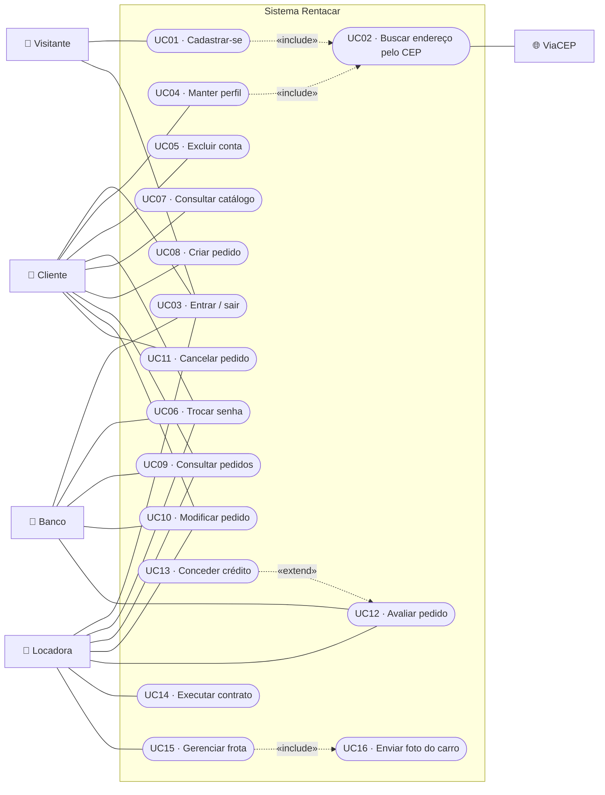
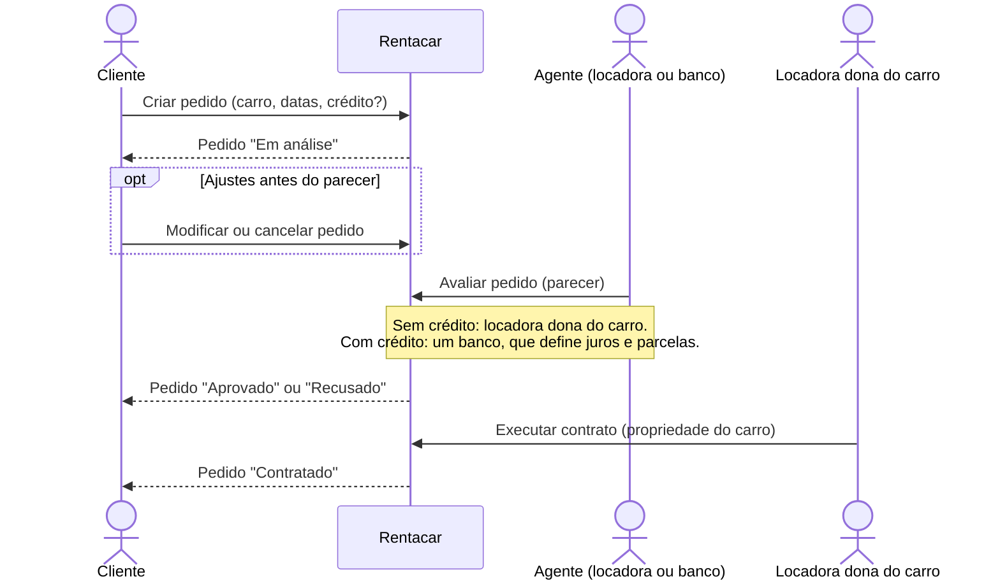

# 🎭 Diagrama de Casos de Uso

Atores e casos de uso do **Rentacar — Sistema de Aluguel de Carros**. As histórias de usuário que detalham cada caso estão em [historias-de-usuario.md](historias-de-usuario.md).

## Atores

| Ator             | Descrição                                                                                                        |
| ---------------- | ---------------------------------------------------------------------------------------------------------------- |
| 🧍 **Visitante** | Pessoa sem login. Só pode se cadastrar como cliente e entrar.                                                    |
| 🧑 **Cliente**   | Pessoa física cadastrada. Faz e acompanha pedidos de aluguel.                                                    |
| 🏢 **Locadora**  | Agente do tipo empresa, dona de uma frota. Avalia os pedidos sem crédito dos seus carros e executa os contratos. |
| 🏦 **Banco**     | Agente do tipo banco. Avalia os pedidos com crédito e concede o contrato de crédito.                             |
| 🌐 **ViaCEP**    | Serviço externo de consulta de endereço pelo CEP.                                                                |

Locadora e banco são especializações de **Agente**; cliente, locadora e banco são **usuários autenticados**.

## Diagrama

## Descrição dos casos de uso

| ID   | Caso de uso              | Atores                              | Descrição                                                                                | História |
| ---- | ------------------------ | ----------------------------------- | ---------------------------------------------------------------------------------------- | -------- |
| UC01 | Cadastrar-se             | Visitante                           | Cria a conta de cliente com identificação, endereço, profissão e até 3 rendimentos.      | US01     |
| UC02 | Buscar endereço pelo CEP | (incluído em UC01 e UC04), ViaCEP   | Preenche rua, bairro, cidade e UF a partir do CEP.                                       | US01     |
| UC03 | Entrar / sair            | Visitante, Cliente, Locadora, Banco | Inicia e encerra a sessão com e-mail e senha.                                            | US02     |
| UC04 | Manter perfil            | Cliente                             | Consulta e edita os próprios dados (CPF e e-mail fixos).                                 | US03     |
| UC05 | Excluir conta            | Cliente                             | Desativa a conta (exclusão lógica) e encerra a sessão.                                   | US04     |
| UC06 | Trocar senha             | Cliente, Locadora, Banco            | Altera a senha informando a atual.                                                       | US05     |
| UC07 | Consultar catálogo       | Cliente                             | Lista e busca os carros disponíveis.                                                     | US06     |
| UC08 | Criar pedido             | Cliente                             | Pede o aluguel de um carro para um período, com ou sem crédito.                          | US07     |
| UC09 | Consultar pedidos        | Cliente, Locadora, Banco            | O cliente vê os seus pedidos; os agentes veem todos.                                     | US08     |
| UC10 | Modificar pedido         | Cliente, Locadora, Banco            | Altera as datas de um pedido em análise (o agente, só dos pedidos que avalia).           | US09     |
| UC11 | Cancelar pedido          | Cliente                             | Cancela um pedido em análise.                                                            | US10     |
| UC12 | Avaliar pedido           | Locadora, Banco                     | Registra o parecer financeiro: aprova ou recusa.                                         | US11     |
| UC13 | Conceder crédito         | Banco (estende UC12)                | Ao aprovar um pedido com crédito, define juros e parcelas e gera o contrato de crédito.  | US12     |
| UC14 | Executar contrato        | Locadora                            | Formaliza o aluguel de um pedido aprovado e registra a propriedade do carro no contrato. | US13     |
| UC15 | Gerenciar frota          | Locadora                            | Cadastra, edita e exclui os próprios carros.                                             | US14     |
| UC16 | Enviar foto do carro     | (incluído em UC15)                  | Envia a foto (JPEG, PNG ou WebP, até 2 MB) para o armazenamento.                         | US14     |

## Fluxo principal: do pedido ao contrato

