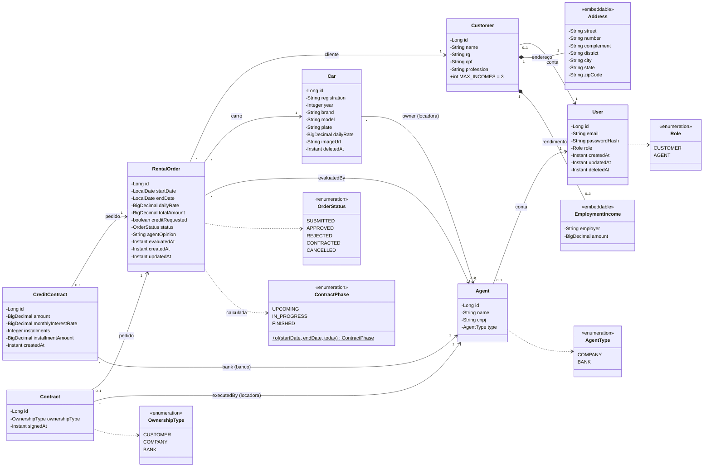

# 🧩 Diagrama de Classes

Modelo de domínio do **Rentacar** (pacote `com.lucas.rentacar.model` e enums de `com.lucas.rentacar.enums`). As classes são entidades JPA; `Address` e `EmploymentIncome` são objetos embutidos (`@Embeddable`), sem identidade própria.

## Classes

| Classe             | Responsabilidade                                                                                                          |
| ------------------ | ------------------------------------------------------------------------------------------------------------------------- |
| `User`             | Conta de acesso: e-mail, senha (hash BCrypt) e papel. A exclusão é lógica (`deletedAt`).                                  |
| `Customer`         | Dados do cliente pedidos no enunciado: nome, RG, CPF, profissão, endereço e até 3 empregadores com os rendimentos.        |
| `Address`          | Endereço do cliente, gravado nas colunas da própria tabela `customers`.                                                   |
| `EmploymentIncome` | Entidade empregadora e rendimento mensal; gravado na tabela `customer_incomes`.                                           |
| `Agent`            | Locadora (`COMPANY`) ou banco (`BANK`), com um login por organização.                                                     |
| `Car`              | Automóvel com matrícula (RENAVAM), ano, marca, modelo, placa, diária, foto e a locadora dona.                             |
| `RentalOrder`      | Pedido de aluguel: período, valores (diária copiada no momento do pedido), status, pedido de crédito e parecer do agente. |
| `CreditContract`   | Crédito concedido por um banco para pagar o aluguel: valor, juros ao mês, parcelas e valor da parcela (Tabela Price).     |
| `Contract`         | Contrato executado pela locadora, com o tipo de propriedade do carro durante o aluguel.                                   |
| `ContractPhase`    | Fase de um pedido contratado, calculada pelas datas (não é gravada).                                                      |

## Regras representadas

- Um `User` tem **um** perfil: `Customer` (papel `CUSTOMER`) **ou** `Agent` (papel `AGENT`).
- Um cliente tem **no máximo 3** rendimentos.
- `Car.owner` é sempre uma locadora; `CreditContract.bank` é sempre um banco; `Contract.executedBy` é a locadora dona do carro.
- Um pedido tem **no máximo um** contrato de crédito (só se `creditRequested` e aprovado por um banco) e **no máximo um** contrato.
- `OwnershipType.BANK` só é aceito quando o pedido tem contrato de crédito.
- O ciclo de vida de `OrderStatus` está no [README](../README.md#-regras-de-negócio-e-decisões-de-projeto).
