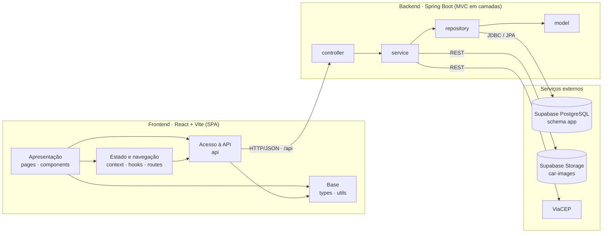
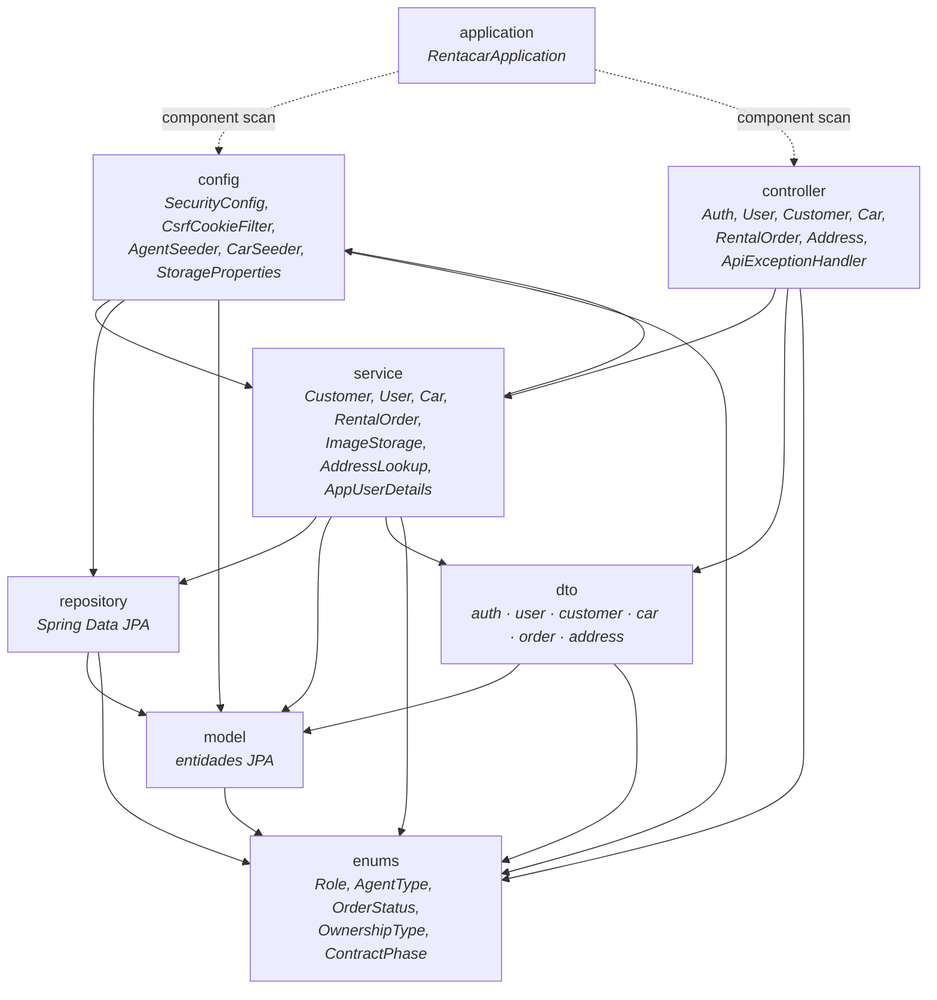
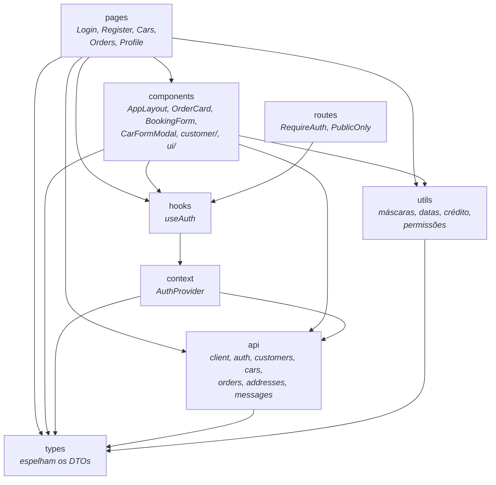

# 📦 Diagrama de Pacotes (Visão Lógica)

Organização lógica do **Rentacar** em pacotes e as dependências entre eles. As setas indicam "depende de" (usa classes de). As dependências foram levantadas dos `import` do código.

## Visão geral

## Backend (`com.lucas.rentacar`)

| Pacote        | Camada (MVC)                  | Responsabilidade                                                                                                 |
| ------------- | ----------------------------- | ---------------------------------------------------------------------------------------------------------------- |
| `application` | —                             | Classe principal; inicia o Spring e define o pacote base.                                                        |
| `controller`  | **Controller**                | Endpoints REST: recebe e valida os DTOs, chama os services e devolve DTOs. Inclui o tratamento de erros em JSON. |
| `service`     | **Model** (regras de negócio) | Regras do domínio: cadastro, pedidos, avaliação, crédito, contrato, frota; integrações com o Storage e o ViaCEP. |
| `repository`  | **Model** (persistência)      | Interfaces Spring Data JPA e consultas (disponibilidade, filtros).                                               |
| `model`       | **Model** (entidades)         | Entidades JPA mapeadas para as tabelas do schema `app`.                                                          |
| `dto`         | Contrato da API               | Objetos de entrada (com Bean Validation) e de saída; as entidades nunca são expostas.                            |
| `enums`       | Domínio                       | Papéis, tipos de agente, status do pedido, tipo de propriedade e fase do contrato.                               |
| `config`      | Infraestrutura                | Segurança (sessão, CSRF, CORS, permissões por papel), _seeds_ de agentes e carros, propriedades do Storage.      |

> A **View** do MVC é o frontend React, que consome a API em JSON.

## Frontend (`frontend/src`)

| Pacote              | Responsabilidade                                                                            |
| ------------------- | ------------------------------------------------------------------------------------------- |
| `pages`             | Uma tela por rota.                                                                          |
| `components`        | Layout, cards, formulários e componentes de interface reutilizáveis (`ui/`).                |
| `routes`            | Proteção das rotas conforme o login.                                                        |
| `context` · `hooks` | Sessão do usuário compartilhada pelo app.                                                   |
| `api`               | Cliente HTTP (sessão e CSRF), chamadas por recurso e tradução das mensagens da API.         |
| `types`             | Tipos TypeScript equivalentes aos DTOs do backend.                                          |
| `utils`             | Máscaras (CPF, CEP), datas e moeda, cálculo de parcelas e regras de permissão na interface. |
