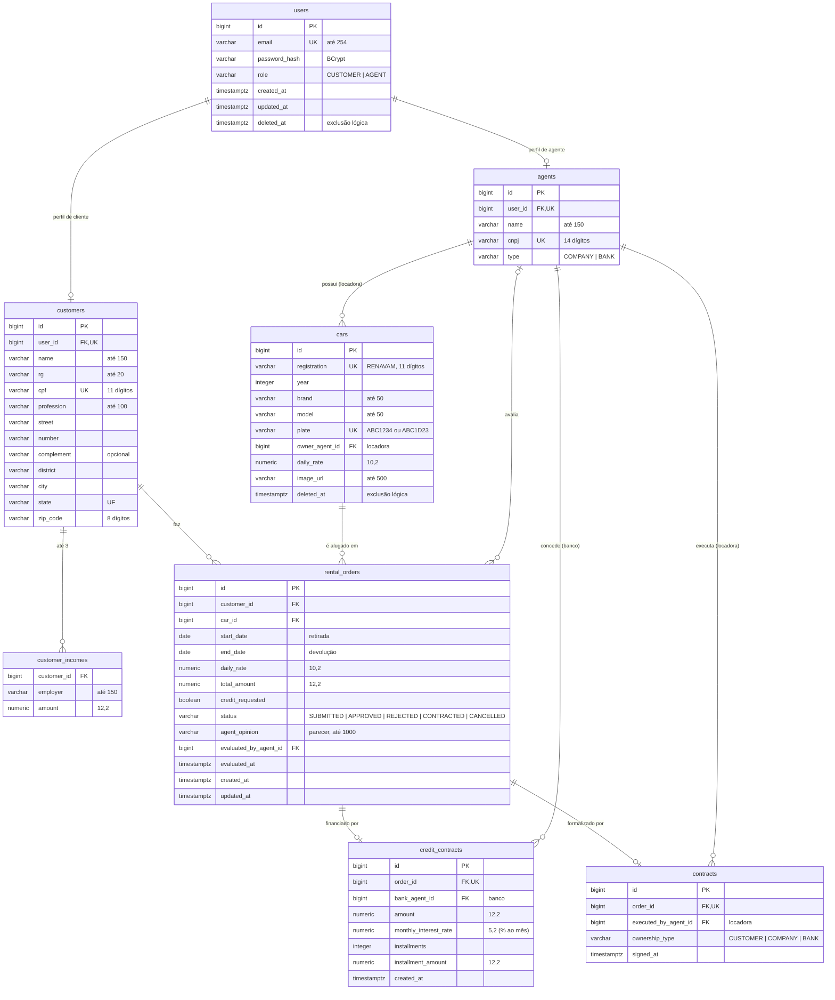

# 🗃 Modelo de Dados

Tabelas do **Rentacar** no PostgreSQL do Supabase, todas no schema **`app`**. São geradas pelo Hibernate a partir das entidades (veja o [diagrama de classes](diagrama-de-classes.md)), com nomes em `snake_case`.

## Tabelas

| Tabela             | Conteúdo                   | Observações                                                                |
| ------------------ | -------------------------- | -------------------------------------------------------------------------- |
| `users`            | Contas de acesso           | `email` único; `role` define o perfil                                      |
| `customers`        | Clientes (pessoa física)   | 1:1 com `users`; endereço embutido nas colunas; `cpf` único                |
| `customer_incomes` | Empregadores e rendimentos | Até 3 por cliente (validado na API)                                        |
| `agents`           | Locadoras e bancos         | 1:1 com `users`; `cnpj` único                                              |
| `cars`             | Frota                      | `plate` e `registration` únicos; `owner_agent_id` aponta para uma locadora |
| `rental_orders`    | Pedidos de aluguel         | Diária copiada do carro; `status` gravado; a fase do contrato é calculada  |
| `credit_contracts` | Contratos de crédito       | 1:1 com o pedido; criado quando um banco aprova um pedido com crédito      |
| `contracts`        | Contratos de aluguel       | 1:1 com o pedido; criado quando a locadora executa o contrato              |

## Regras garantidas no banco e na API

- **Unicidade:** e-mail, CPF, CNPJ, placa e RENAVAM; um perfil por usuário; um contrato de crédito e um contrato por pedido.
- **Exclusão lógica:** `users.deleted_at` e `cars.deleted_at`; as linhas não são apagadas, para preservar o histórico de pedidos.
- **Na API (services):** máximo de 3 rendimentos, datas sobrepostas para o mesmo carro, transições de status e quem pode executar cada ação.

## Armazenamento de arquivos

As fotos enviadas pelas locadoras ficam no **Supabase Storage**, no bucket público `car-images` (`cars/{id do carro}/{uuid}.{extensão}`). A coluna `cars.image_url` guarda a URL pública. As fotos da frota inicial ficam em `frontend/public/cars` e são referenciadas por caminho (`/cars/fiat-argo.webp`).
